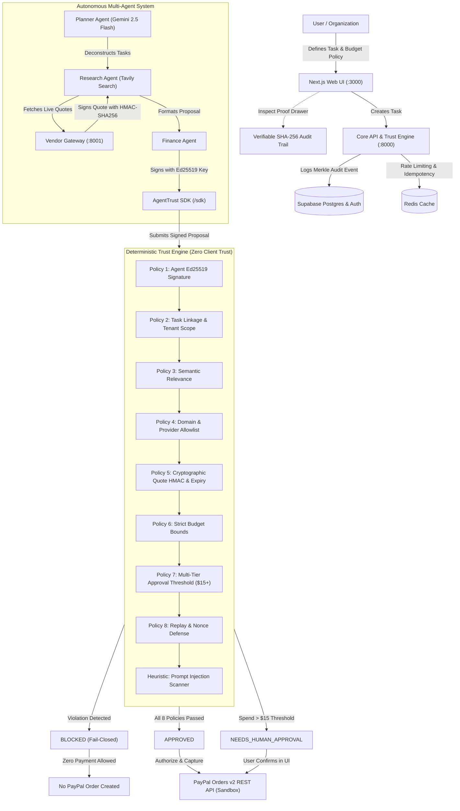

# Nirbhar AI — Autonomous Agent Payment Gateway & Trust Layer

> An independent, deterministic trust and authorization firewall sitting between autonomous AI agents and real financial payment rails (PayPal Sandbox).

[](https://github.com/atharvajoshi189/Nirbhar-AI/actions/workflows/ci.yml)
[](tests/)
[](LICENSE)
[](https://www.python.org/)
[](https://nextjs.org/)

---

## Architecture Overview

Nirbhar AI prevents autonomous AI agents from executing unconstrained, tampered, or out-of-policy financial transactions. Agents **never** receive direct access to payment credentials or payment APIs. Instead, agents propose cryptographically signed payment intents to the **Deterministic Trust Engine**, which enforces hard mathematical constraints, HMAC quote verification, budget caps, allowlists, and prompt injection heuristics before interacting with PayPal.



---

## Monorepo Layout

```
Nirbhar-AI/
├── api/                   # FastAPI backend orchestrator & Deterministic Trust Engine (:8000)
│   ├── app/
│   │   ├── core/          # Redis client, Sentry, structured logging
│   │   ├── db/            # Supabase database & auth client
│   │   ├── middleware/    # Sliding-window rate limiting & mutating idempotency cache
│   │   ├── routers/       # REST endpoints (trust, tasks, audit, red-team, health)
│   │   └── services/      # Merkle audit chain, agents, PayPal gateway
│   ├── trust_engine/      # 8 deterministic rules, risk scorer, composite evaluator
│   └── requirements.txt
├── vendor-gateway/        # Sandboxed merchant checkout & HMAC quote provider (:8001)
├── web/                   # Next.js 16 App Router frontend & Proof Drawer UI (:3000)
├── sdk/                   # agenttrust Python SDK (Ed25519 signing & verification)
├── tests/                 # Consolidated pytest suite (74 tests) & load testing harnesses
├── reports/               # Formal phase verification reports and visual proof artifacts
├── docker-compose.yml     # Full-stack container orchestration
├── render.yaml            # Render infrastructure-as-code blueprint
├── vercel.json            # Vercel deployment configuration
└── PROJECT_RULES.md       # Mandatory architectural standards & non-negotiable rules
```

---

## Quick Start & Setup

### Prerequisites
- **Python**: 3.11 or higher
- **Node.js**: 20.x or higher (npm 10+)
- **Git**: Installed and configured

### 1. Clone Repository & Setup Environment
```bash
git clone https://github.com/atharvajoshi189/Nirbhar-AI.git
cd Nirbhar-AI

# Create your local environment configuration
cp .env.example .env
```
Populate `.env` with your real sandbox credentials (see [Environment Variables](#environment-variables)).

---

### 2. Running Services Locally

#### Option A: Native Multi-Terminal (Recommended for Development)

**Terminal 1: Core API & Trust Engine (:8000)**
```bash
cd api
python -m venv .venv
# On Windows: .venv\Scripts\activate
# On Linux/macOS: source .venv/bin/activate
pip install -r requirements.txt
pip install -e ../sdk
uvicorn app.main:app --host 127.0.0.1 --port 8000 --reload
```

**Terminal 2: Vendor Gateway (:8001)**
```bash
cd vendor-gateway
python -m venv .venv
# activate venv
pip install -r requirements.txt
uvicorn app.main:app --host 127.0.0.1 --port 8001 --reload
```

**Terminal 3: Next.js Web Frontend (:3000)**
```bash
cd web
npm install
npm run dev
```

Open [http://localhost:3000](http://localhost:3000) in your browser.

#### Option B: Docker Compose
```bash
docker-compose up --build
```

---

## Environment Variables Reference

All credentials and runtime configurations are managed exclusively via environment variables:

| Variable | Required | Description | Example |
| :--- | :--- | :--- | :--- |
| `API_PORT` | Yes | Port for Core API | `8000` |
| `API_BASE_URL` | Yes | Public or internal Core API URL | `http://localhost:8000` |
| `VENDOR_GATEWAY_PORT` | Yes | Port for Vendor Gateway | `8001` |
| `VENDOR_GATEWAY_URL` | Yes | URL for Vendor Gateway quote issuer | `http://localhost:8001` |
| `WEB_PORT` | Yes | Port for Next.js Web UI | `3000` |
| `NEXT_PUBLIC_API_URL` | Yes | API URL accessible by browser clients | `http://localhost:8000` |
| `GEMINI_API_KEY` | Yes | Google Gemini API key for agent reasoning | `AIzaSy...` |
| `GEMINI_MODEL` | No | Gemini model variant | `gemini-2.5-flash` |
| `SUPABASE_URL` | Yes | Authoritative Supabase project URL | `https://xyz.supabase.co` |
| `SUPABASE_ANON_KEY` | Yes | Supabase client publishable key | `sb_publishable_...` |
| `SUPABASE_SERVICE_ROLE_KEY`| Yes | Server-side privileged admin key | `sb_secret_...` |
| `NEXT_PUBLIC_SUPABASE_URL` | Yes | Supabase URL exposed to frontend | `https://xyz.supabase.co` |
| `NEXT_PUBLIC_SUPABASE_ANON_KEY`| Yes | Supabase publishable key for frontend | `sb_publishable_...` |
| `PAYPAL_CLIENT_ID` | Yes | PayPal Sandbox REST API App Client ID | `BAA5kkw...` |
| `PAYPAL_CLIENT_SECRET` | Yes | PayPal Sandbox REST API Secret | `EAnUuHb...` |
| `PAYPAL_ENVIRONMENT` | Yes | Environment selector | `sandbox` |
| `PAYPAL_API_BASE` | Yes | PayPal REST API endpoint | `https://api-m.sandbox.paypal.com` |
| `PAYPAL_WEBHOOK_ID` | No | Registered PayPal Sandbox Webhook ID | `7ED4925...` |
| `TAVILY_API_KEY` | Yes | Tavily Search API key for research agent | `tvly-...` |
| `REDIS_URL` | Yes | Redis connection string (with fallback) | `redis://localhost:6379/0` |
| `JWT_SECRET` | Yes | 32-byte secret for session tokens | `41e123...` |
| `QUOTE_HMAC_SECRET` | Yes | Secret shared between Vendor GW and Core API | `nirbhar_quote_secret_2026` |
| `RATE_LIMIT_PER_MINUTE` | No | Sliding-window request cap (default 240) | `240` |
| `IDEMPOTENCY_TTL_SECONDS`| No | Cache TTL for mutating requests | `86400` |
| `SENTRY_DSN` | No | Sentry monitoring connection string | `https://...` |

---

## AgentTrust Python SDK (`/sdk`)

Nirbhar AI provides a pip-installable client library (`agenttrust`) enabling autonomous agents to generate cryptographic identities, sign proposals, and verify transactions:

### Installation
```bash
pip install ./sdk
```

### Usage Example
```python
import agenttrust

# 1. Generate Ed25519 identity keypair
private_key, public_key = agenttrust.generate_keypair()

# 2. Build payment proposal
proposal = {
    "amount": 12.00,
    "currency": "USD",
    "provider_name": "CloudScale Infrastructure Solutions",
    "provider_url": "https://cloudscale.io/api",
    "proposal_category": "cloud_compute",
    "justification": "Procure build worker for automated CI indexing.",
    "signer_pubkey": public_key,
    "bypass_advisory_llm": True
}

# 3. Cryptographically sign proposal
signed_proposal = agenttrust.sign(proposal, key=private_key)

# 4. Verify against live Nirbhar AI Trust Engine
result = agenttrust.verify(signed_proposal, api_base="http://127.0.0.1:8000")

print(f"Decision:     {result.decision}")       # APPROVED, NEEDS_HUMAN_APPROVAL, or BLOCKED
print(f"Risk Score:   {result.risk_score}")     # 0.0 to 10.0
print(f"Proof SHA256: {result.proof_chip['sha256']}")
```

---

## Testing & Verification

The test suite covers unit rules, adversarial attacks, PayPal integrations, and cryptographic audit chains:

```bash
# Run full consolidated pytest test suite (74 tests)
pytest tests/ -v

# Run Red Team attack simulation suite (6 real attacks)
pytest tests/test_red_team_suite.py -v

# Run Phase 8 SDK & resilience suite
pytest tests/test_phase8_sdk_and_resilience.py -v

# Run High-Concurrency Load Test
python tests/load/run_load_test.py
```

---

## Limitations

Nirbhar AI is engineered with rigorous fail-closed security, zero client trust, and unmocked verification. Prospective deployers and evaluators must understand the following explicit boundaries:

1. **PayPal Sandbox Only**:
   - Nirbhar AI is currently integrated and verified exclusively against the **PayPal REST Orders v2 Sandbox API** (`https://api-m.sandbox.paypal.com`).
   - It does **not** process live production financial settlement. Live payment execution requires an approved, underwritten PayPal production developer account, verified business bank account, and commercial webhook setup.
2. **No Custodial Escrow**:
   - Approved transactions settle **directly** from the authorized account to the target merchant's PayPal account upon execution.
   - Nirbhar AI is **not** a financial escrow custodian, bank, or money transmitter. It does not operate a multi-signature escrow holding pool, custodial vault, or smart-contract escrow reserve.
3. **No Claim of Detecting Every Malicious Agent**:
   - The Trust Engine enforces strict deterministic math, HMAC quote verification, tenant isolation, domain allowlists, and prompt injection pattern heuristics.
   - However, **no claim is made that the Trust Engine can detect every conceivable malicious agent or zero-day adversarial attack**. Sophisticated adversarial ML techniques, prompt extraction mutations, social engineering, or colluding agents may circumvent heuristic scanners.
   - For this reason, Nirbhar AI employs **defense-in-depth**: hard budget caps ($20 default), an mandatory human approval threshold for any spend over \$15, and an immutable SHA-256 Merkle audit trail for complete post-execution accountability.
